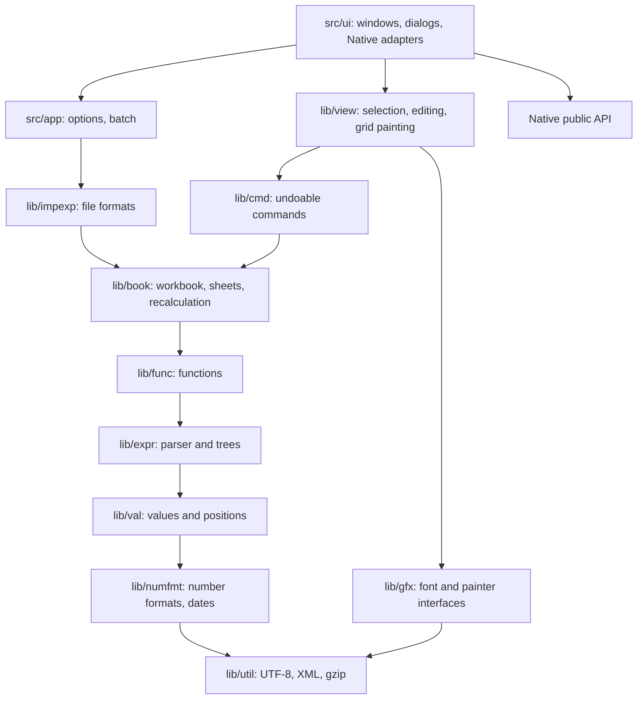

# Isaac architecture

Isaac is Gnumeric rebuilt from the ground up on the Native UI library. It reads
and writes Gnumeric's `.gnumeric` format and keeps the ideas that make Gnumeric
work. It replaces the C code, GObject, GTK and goffice with modern C++20 and one
UI layer.

This records the decisions and why they were made. Port coverage is in
[notes/PORT-STATUS.md](notes/PORT-STATUS.md).

## Layers

Dependencies point downward only. Everything except `src/ui/` builds and tests
without a display.

| Library | Gnumeric origin | Holds |
| --- | --- | --- |
| `lib/util` | `gutils`, libgsf | UTF-8, case mapping, XML, gzip, colors |
| `lib/numfmt` | goffice `go-format`, `number-match`, `gnm-datetime` | Number formats, entry recognition, date serials |
| `lib/val` | `value`, `position`, `ranges` | Values, cell positions, A1 names |
| `lib/expr` | `expr`, `parser.y`, `func` | Formula trees, parser, function table |
| `lib/func` | `collect`, `criteria`, `mathfunc`, `plugins/fn-*` | 389 spreadsheet functions |
| `lib/book` | `workbook`, `sheet`, `cell`, `colrow`, `mstyle`, `dependent`, `clipboard`, `sheet-autofill`, `sort`, `search` | The workbook and its calculation |
| `lib/cmd` | `commands` | Undoable commands |
| `lib/impexp` | `xml-sax-*`, `stf`, `plugins/html` | Gnumeric XML, CSV, HTML |
| `lib/gfx` | none | `font_provider` and `painter` interfaces |
| `lib/view` | `sheet-view`, `selection`, `item-grid`, `cell-draw`, `item-edit`, `wbc-gtk-edit` | Interaction and grid painting |
| `src/ui` | `wbc-gtk`, `sheet-control-gui`, `item-bar`, `dialogs/` | Native front end |

All application UI uses Native's public API. No file outside Native includes
SDL or any other toolkit header. A missing UI capability is added to Native,
following Native's own rules. See [notes/NATIVE-CHANGES.md](notes/NATIVE-CHANGES.md).

## Decisions

### One suite with Writer

Isaac's shell is Writer's: the same 1000×760 window, the same File, Edit, View,
Insert, Format and Help menus with the same shortcuts, the same toolbar order,
the same format bar of hosted combo boxes, the same four-part status bar and the
same Find and Replace window. Data is the one added menu. The 17 icons they share
are byte-identical, and the nine spreadsheet tools are drawn in the same hand by
the same exporter. A user of one knows the other.

### Values are a variant

Gnumeric's `GnmValue` tagged union of allocated structs becomes a `std::variant`
with value semantics. Strings and arrays are shared and immutable, so copying a
value is cheap and no code counts references by hand.

The engine reaches cells through the abstract `val::cell_source`. Values and
expressions therefore know nothing of sheets, and `lib/expr` tests need none.

### A node class per operator

`GnmExpr` is a tagged union walked by large switches. Here each operator is a
class that evaluates, prints, reports what it reads and rewrites itself. Adding
an operator touches one class instead of every switch.

Trees are immutable and shared. A relative reference keeps offsets, not
positions, so one tree serves every cell of a filled column, exactly as
Gnumeric's `ExprID` shared expressions do, and copying a formula is copying a
pointer. A structural edit returns new trees and leaves unchanged ones shared.

### Functions declare their arguments

Gnumeric's one-letter argument spec survives: `"ff|f"` means two numbers and an
optional one. The call node coerces, checks and, in array formulas, iterates, so
a function body sees only what it asked for. Functions that must see unevaluated
arguments (`IF`, the aggregates) take nodes.

### Calculation walks a stack

Gnumeric recurses from a cell into its inputs and guards the depth. Isaac keeps
an explicit stack: a cell is computed after its stale inputs, found through the
per-sheet ordered sets of dirty rows. A chain as long as a sheet needs no special
case, and reading a running total costs a logarithm per input instead of a scan.

A cycle shows as an input already on the stack. Everything above it is a member.
Members iterate under the workbook's limit and tolerance, then whatever read them
is recalculated. This is Gnumeric's protocol without its recursion.

### Reverse edges hash by row bucket

The dependency graph keeps Gnumeric's scheme: single cells hash directly, and
ranges hash into buckets of 1024 rows, so a change inspects only ranges near it.
Structural edits rebuild the graph, which is linear in formulas; they are rare,
and there is no incremental case to get wrong.

### Styles are runs, not a tree

`sheet-style.c`'s quad-tree of style tiles is 3,300 lines. A style here is an
immutable value, interned so equal styles are one object, and each column keeps
an interval map from row to style. A whole column of one style is one entry,
and comparing styles is comparing pointers. Saving merges columns with equal
runs back into Gnumeric's regions.

### Sizes are points; pixels are derived

Column and row sizes stay in points, as in the file. `book::axis` stores the
default and the exceptions, with cumulative offsets over the exceptions, so
position lookups stay logarithmic even on a million rows. Zoom changes the
scale and nothing else.

### Undo is mementos

Each user action is a `cmd::command`. Most remember the rectangle they touch,
so undo cannot drift from do. A structural edit also records every formula it
rewrote and restores them verbatim, because mapping a deleted reference back is
impossible. `test_undo_fidelity` runs every command at three selection sizes and
compares the whole workbook after undo.

### One editor, two places

Gnumeric's formula entry and in-cell editor share a `GtkEntry`. Isaac's
`view::cell_editor` is a model both show. The keyboard stays on the grid; clicking
the formula bar places the caret and returns focus. Pointing at a reference
needs caret access that Native's `text_edit` does not offer on any backend, so
the bar is a canvas, not a text field. See
[notes/NATIVE-CHANGES.md](notes/NATIVE-CHANGES.md).

### Headers are rulers

The column and row headers derive from `native::ruler`, keeping its docking,
shared corner and pointer routing. Painting and gestures are overridden. The grid
therefore sits inside its headers as Writer's page sits inside its rulers.

### Everything testable sits below the UI

`lib/view` holds navigation, selection, editing, the clipboard and all painting
through `gfx::painter`. Named commands in `view::run_command` serve menus, toolbars
and keys alike. `src/ui` forwards input and presents the result, which is why
1,801 checks run with no display.

### No gray on monochrome backends

The palette tells the view when the backend is monochrome: grid lines then dither
in black, as GEM and X11 have no gray. The selection is Native's, through
`theme::draw_selection`, so those backends get black with white text and color
backends get their own highlight.

### File format compatibility

`.gnumeric` is the native format, gzipped on writing, either way on reading.
What Isaac does not model is not lost: sheet parts such as charts, print settings
and solver setups are re-serialized from the parse events and written back
verbatim. Style features the model lacks are reported through
`import_result::warnings`. Saving writes a sibling temporary file and renames it,
so a failed save cannot destroy the previous document.

Formula cells carry no cached result in the format, so a loaded workbook is
fully recalculated.

### No third-party dependencies below the UI

Gnumeric needs libgsf, libxml2, zlib, goffice, glib and pango. The libraries here
need only the C++ standard library: gzip and XML are small and exact, and goffice's
format language is reimplemented from its documented grammar. `isaac-headless`
therefore links nothing else, which is what makes it useful as a converter.

### Licensing

See [notes/LICENSING.md](notes/LICENSING.md).
